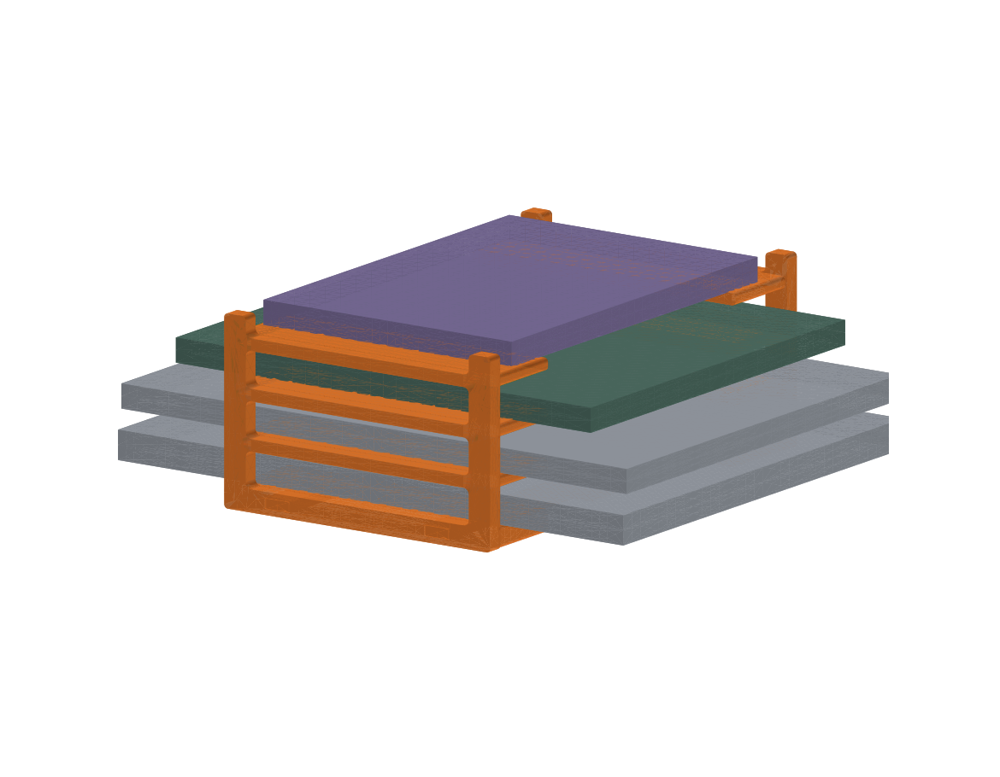
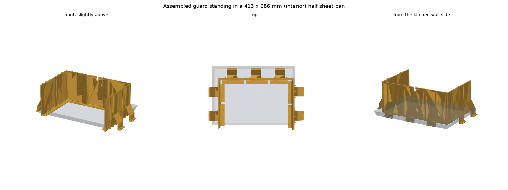

# 3D prints

Things designed in Python and printed in PETG on a Bambu Lab A1 mini. Each
print has its own directory with the model script, the STLs, the sliced plates
and `final.png`, a render of the finished product.

**See them in 3D: https://github.ekkylab.uk/3d-prints/**

| Print | What it is | |
|---|---|---|
| [tablet-rack](tablet-rack) | A rack that holds four tablets lying flat, one above another. Two sides and two spliced rails, no glue or screws. |  |
| [flair-splash-guard](flair-splash-guard) | Seven interlocking wall panels that stand in a half sheet pan around a Flair 58 espresso press. |  |

## Layout of a print

```
<print>/
  README.md      what it is, what to print, how to assemble it
  final.png      render of the finished product
  <model>.py     parametric source (manifold3d + trimesh)
  stl/           one STL per part
  sliced/        .gcode.3mf plates for the A1 mini
  previews/      other renders
```

`index.html` is the viewer behind the link above. It reads `prints.json`, so a
new print shows up there once it has an entry listing its STLs.

The sliced files are for an A1 mini with a 0.4 mm nozzle, a textured PEI plate
and PETG. For any other printer, slice the STLs yourself.

## The skill

[`skill/bambu-a1mini-print`](skill/bambu-a1mini-print) is the Claude Code skill
these prints were made with: CAD helpers, a slicing script for the Bambu
Studio command line, the procedure for sending a plate through Bambu Studio,
notes on what this printer and filament did (including the failures), and
[research on joining printed parts](skill/bambu-a1mini-print/references/joinery-notes.md). It
describes one specific setup, an A1 mini driven from a macOS virtual machine
through the Bambu cloud, so treat it as an example to adapt. To use it, copy
the folder to `~/.claude/skills/`.
