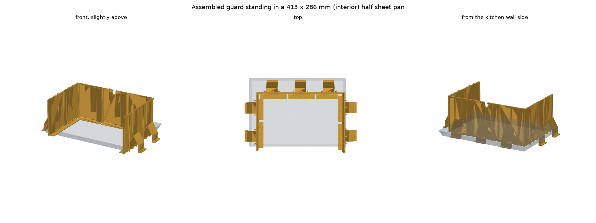

# Flair 58 splash guard for a half sheet pan (Bambu Lab A1 mini)

Seven interlocking wall panels that stand inside the sheet pan, straddle its rim
so they cannot tip, and overlap at every seam. Printed on an A1 mini
(180 x 180 x 180 mm), one or two panels per plate.



```
 top view (interior = where the Flair stands, open side toward you)

      S2 ┌──── B1 ────┬──── B2 (cable notch) ────┬──── B3 ────┐ 
         │                                                     │
      S1 │                                                     │ S3
         │                                                     │
         ╵                                                     ╵ S4
```

## Files

| file | what |
|---|---|
| `stl/panel_straight.stl` | straight panel, print 4 |
| `stl/panel_straight_cable.stl` | straight panel with a 14 mm cord notch in the top edge, print 1 |
| `stl/panel_corner.stl` | corner panel (channel turned 90 degrees), print 2 |
| `sliced/splash_guard_A1mini.gcode.3mf` | the 5 remaining panels packed two per plate (not recommended, see Printing), sliced by Bambu Studio 2.09 for A1 mini, 0.20 mm Standard, your COMGROW PETG Basic preset, textured PEI plate |
| `sliced/per_plate/plate_1..5.gcode.3mf` | the five remaining panels, one centred panel per file, for sending one at a time |
| `sliced/test_panel_straight.gcode.3mf` | one straight panel, same settings, for the fit test |
| `assembly.stl` | the whole U assembled, for checking fit in CAD |
| `splash_guard.py` | parametric source (manifold3d); edit the numbers at the top and rerun |
| `slice_a1mini.py` | re-slices with the Bambu Studio CLI using properly flattened A1 mini profiles |
| `render_previews.py` | writes the PNGs in `previews/` |

## How it works

* **Foot flange + rim saddle.** Each panel stands on a 22 mm flange on the pan
  floor. A 50 mm wide saddle arches over the pan rim and puts a leg, with a
  12 mm outward foot, down on the counter outside the pan, so the wall is
  captured on both sides of the rim and cannot fall in or out. The saddle has
  44 mm of clearance in width and 32 mm in height at the sides (70 mm under the
  peak of its 60 degree roof), so it clears a standard 1 inch rolled rim with
  the wall anywhere from 2 to about 20 mm inboard of the pan side.
* **Overlapped seams.** Each panel has one plain edge and one 8 mm deep sliding
  channel on the other edge. The next panel's plain edge drops into the channel
  from above. Splash would have to make two right-angle turns to get through a
  seam. The corner panels carry the same channel turned 90 degrees, so the
  corners are closed too and nothing needs glue or separate clips.
* **No drip-back onto the coffee.** The machine-facing surface is one flat,
  continuous plane from the top edge to the pan floor. The stiffening bead and the
  saddle are on the outside face only, and the walls are vertical, so anything
  that hits the plastic runs straight down into the sheet pan. Keep the walls at
  the pan edge, as far from the cup as the pan allows.
* **Power cord.** On the gen 1 Flair 58 the cord plugs into the heating collar on
  the brew head and runs down to the controller box and the power brick, so it
  crosses the wall high up, not at the floor. Panel B2 has a rounded 14 x 22 mm
  notch in its top edge for it. The chain is modular, so that panel can go in any
  position, including a side wall.

## Dimensions used (verify against your gear)

| item | value used | source |
|---|---|---|
| Flair 58 footprint | 13.5 to 14 in long x 7.5 in wide, 11 to 11.5 in tall lever down, 24.25 in lever up | retailer spec sheets |
| Half sheet pan exterior | 17.9 x 12.9 x 1 in | Nordic Ware |
| Half sheet pan interior floor | 16.25 x 11.25 in (413 x 286 mm), some pans up to 17.1 x 12.1 in | Nordic Ware / Sur La Table |
| Rim height above pan floor | about 26 mm | 1 in pans |
| A1 mini build volume | 180 x 180 x 180 mm | Bambu profile |

Assembled guard: interior 381 x 254 mm, 170 mm tall, side walls 261 mm long. It
fits any pan whose interior floor is at least 395 x 265 mm and whose rim is no
taller than 30 mm. Before printing all seven, measure your pan's floor length,
floor width, and rim height. If anything differs, change `W`, `SADDLE_H` or
`SADDLE_IN` in `splash_guard.py` and rerun both scripts.

## Printing

* Orientation: as exported, standing on the flange and saddle foot. No supports
  and no bridging: the saddle roof is a 60 degree gable.
* Revision 2 (after the first test panel bowed toward the saddle): wall 3.2 mm
  printed solid with 4 wall loops, three 8 mm ribs on the outside face, saddle
  bridge thinned to 2.8 mm and narrowed to 50 mm, and a 5 mm outer brim. The
  slicer script registers its tweaked process as a user preset named
  "0.20mm Standard @BBL A1M - splash guard" so Bambu Studio keeps those overrides
  when it re-slices the 3MF. That panel stood straight.
* Revision 3 (the flat saddle bridge sagged on its underside): the bridge was
  replaced by a 45 degree gable roof, and the outside ribs now run down to the
  bed instead of stopping 3 mm above it (Bambu Studio flagged that as a floating
  cantilever). The gable failed in PETG: the 45 degree slabs curled, caught the
  nozzle and knocked the thin outer leg over, leaving spaghetti where the roof
  should be. The walls themselves printed fine.
* Revision 4: the roof is a 60 degree gable (each layer sits 96 percent on the
  one below, peak 70 mm above the pan floor), and the outer leg has a 12 mm
  outward foot with a gusset, so it is an L that cannot be knocked over on the
  plate or on the counter. The test panel of this revision printed clean, with
  no support. All plates are sliced from this revision.
* Profile: 0.20 mm Standard, 4 walls, 15 percent infill, sliced with the
  COMGROW PETG Basic preset from your Bambu account (240 C nozzle, 230 C first
  layer, 70 C textured PEI plate). The project carries that one filament; when
  you send a plate, map it to the AMS slot that holds the PETG (slot 2). To
  slice with something else: `python3 slice_a1mini.py --filament "<preset name>"`.
* Plates: one panel per plate, centred. Two 170 mm panels do fit on the A1
  mini bed, but only pressed against the bed edges (first layer from y = 0.2 to
  y = 177 mm, brim clipped off), and a plate laid out that way came loose and
  turned to spaghetti mid-print. Single centred panels have printed reliably.
  The revision 2 and revision 4 test panels are both usable straight panels, so
  the shipped files leave two straight panels out (`--have-straight 2`):
  plates 1 and 2 are straight panels, plate 3 the cable panel, plates 4 and 5
  the corners. About 3.4 h and 137 g per plate, 17 h and 690 g in total.
  `--panels-per-plate 2` restores the two-up layout if you want to risk it.
* Print one straight panel first and test the fit on your pan before committing
  to the rest: `sliced/test_panel_straight.gcode.3mf` (about 3.5 h, 136 g).
  Regenerate it with `python3 slice_a1mini.py --test`.

## Assembly

1. Put the two corner panels and the cable panel where you want them (the cord
   notch wants to be nearest the brew head's heating collar).
2. Stand the first side panel in the pan with its saddle over the rim.
3. Lower the next panel's plain edge into the channel of the one before it.
   Corners: the back panel's plain edge drops into the corner panel's slot and
   butts against the corner panel's inner face.
4. Work your way round. The whole U locks itself together; lift any single panel
   straight up to remove it for washing.

## Rebuilding

```
pip install manifold3d trimesh numpy matplotlib
python3 splash_guard.py        # STLs + assembly.stl
python3 render_previews.py     # previews/*.png
python3 slice_a1mini.py        # sliced/splash_guard_A1mini.gcode.3mf
```

## Notes on the slicing toolchain

* `slice_a1mini.py` drives the Bambu Studio CLI. The CLI does not resolve the
  `inherits` chains in Bambu's bundled profiles (you get PrusaSlicer-era default
  speeds and a 70 h estimate), so the script flattens machine, process and
  filament profiles first.
* A headless CLI run cannot render plate thumbnails, so `fix_3mf_thumbnails.py`
  renders them and adds them to the 3MF afterwards. The script is run
  automatically at the end of `slice_a1mini.py`.
* This Mac is a virtual machine (VirtualMac2,1, paravirtual GPU) and Bambu
  Studio draws through Apple's software OpenGL renderer there. With the stock
  settings the app crashes inside that renderer when the sliced preview is drawn
  (`glsSwapFlush32Supersample`). Fix that works: Preferences, set MSAA to
  Disabled and turn off retina OpenGL (in `BambuStudio.conf`: `msaa_type`
  "Disabled", `use_retina_opengl` false). With that, slicing, Preview and sending
  to the printer over the cloud all work. Do not enable legacy OpenGL: it aborts
  at startup. The app also cannot start while the VM has no attached display.
  The stock config is kept as `BambuStudio.conf.bak-before-msaa-change`.
* Printing without the GUI: copy a file from `sliced/per_plate/` to the printer's
  microSD card and start it from the printer's screen. Those files hold one plate
  each, because the printer only runs the first plate of a file. The four-plate
  `splash_guard_A1mini.gcode.3mf` is for Bambu Studio on a machine with a GPU.
* The CLI cannot slice a project with two filaments (it stops with
  "could not found group_nozzle_info"), so slot assignment happens at print time.
