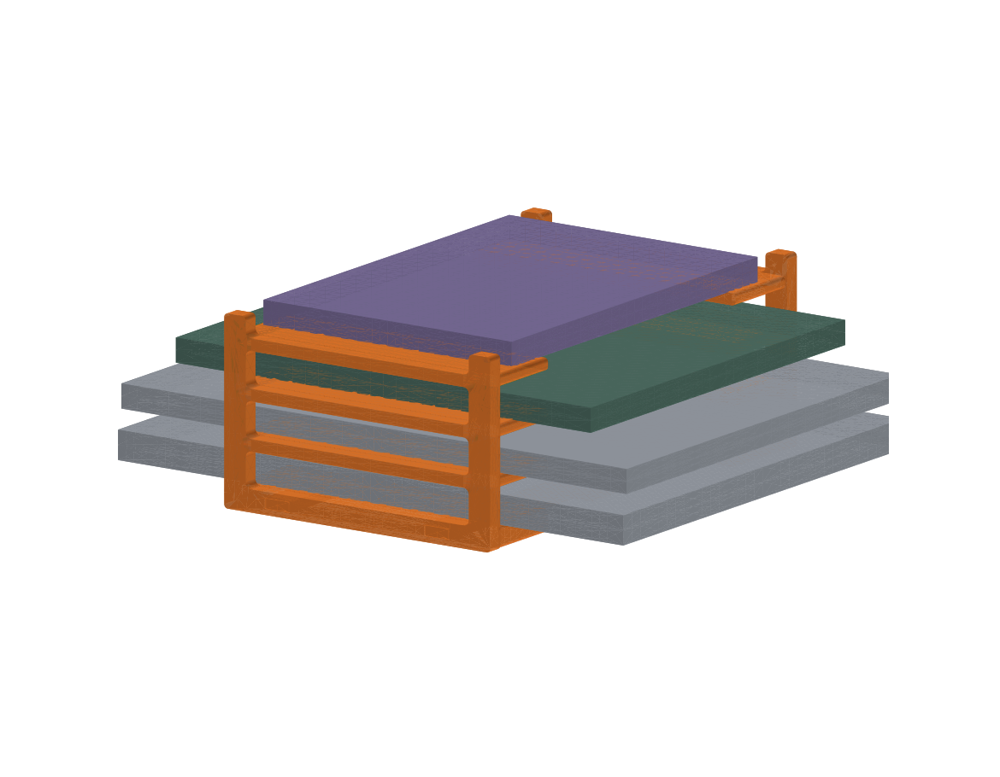

# Tablet rack

A printed rack that holds four tablets lying flat, one above another: two
13 inch iPad Pros, a Kindle Scribe and an iPad mini, all in folio cases.
Printed in PETG on a Bambu Lab A1 mini and assembled without glue or screws.



## The design

- Two side frames, each a closed ladder (front post, back post, one rung per
  level) with a 40 mm ledge along every rung. A tablet slides in from the
  front and rests on a ledge at each long edge, so nothing hangs.
- Two flat cross rails pass through windows in the feet. The rack is 247 mm
  wide, wider than the 180 mm bed, so each rail is two halves joined by a
  round key, with a sleeve slid over the joint.
- Size: 247 wide x 150 deep x 93 mm tall. 231 mm clear between the posts,
  18 mm clear per slot, four levels.

## Parts to print

| File | Parts | Copies | Time | PETG |
|---|---|---|---|---|
| `sliced/plate1_rails_sleeves_coupon.gcode.3mf` | 4 rail halves, 2 sleeves, 1 fit coupon | 1 | 1 h 13 min | 39.5 g |
| `sliced/side.gcode.3mf` | one side | 2 | 3 h 10 min each | 129.3 g each |

The sliced files are for an A1 mini with a 0.4 mm nozzle, textured PEI and
PETG at 0.2 mm layers. The STLs for other printers are in `stl/`. The side
prints lying on its outer face with a 5 mm outer brim and needs no support.

## Assembly

1. Drop a key half into a socket half and slide a sleeve over the joint. Do
   this for both rails.
2. Stand the sides with their ledges facing each other and push the rail ends
   through the foot windows up to the rail's shoulder.

All clearances are 0.15 mm per side and were a hand-push fit as printed.

## Changing it

`ladder.py` is the model: dimensions are named at the top. It needs Python
with `manifold3d` and `trimesh`.

```bash
python3 ladder.py
```

That rewrites `stl/`. `tower.py` and `stack.py` are earlier designs that
`ladder.py` borrows a few shapes from. The research behind the joints is in the
skill:
[`joinery-notes.md`](../skill/bambu-a1mini-print/references/joinery-notes.md).

## The print skill

The CAD helpers that `ladder.py` imports are in
[`../skill/bambu-a1mini-print`](../skill/bambu-a1mini-print), along with the
slicing script and the notes on what this printer and filament did.
